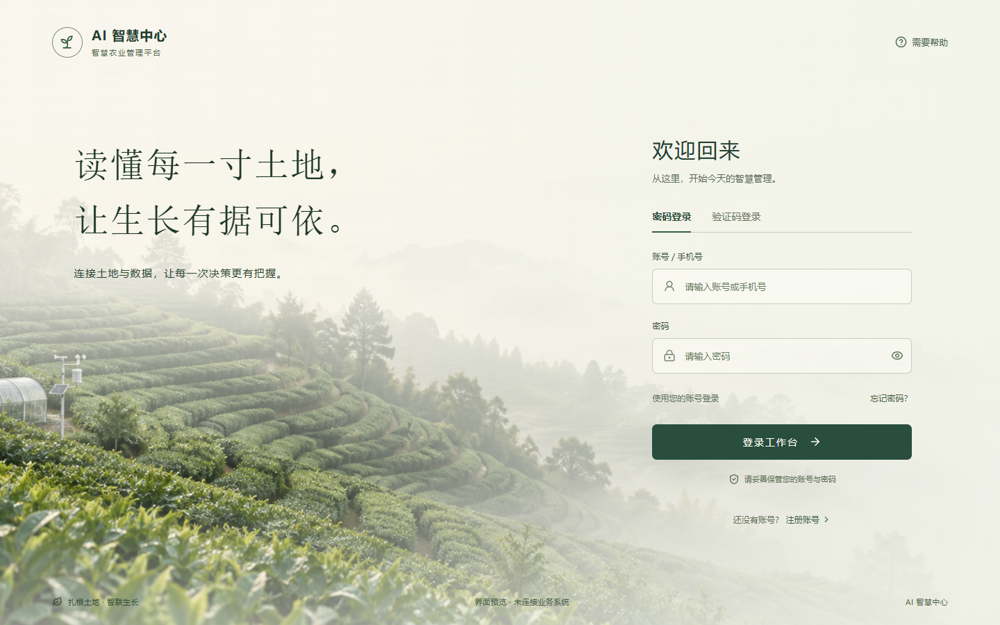
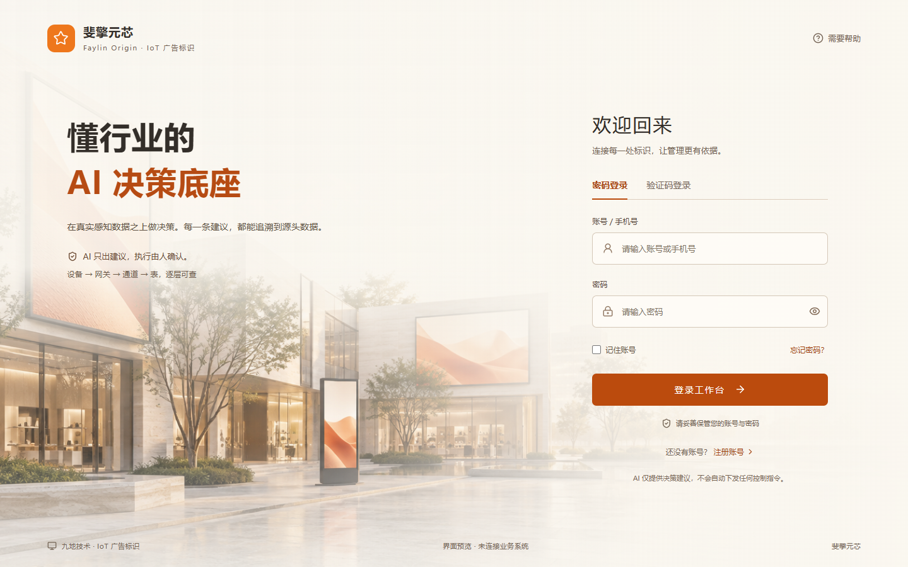

# Company

基于 Vue 3 的智慧农业与 IoT 广告标识登录、注册页面模板。

整页采用连续的田园晨雾背景，登录表单融入同一场景；品牌名称、文案、主色和背景图片可通过配置替换，便于后续用于其他系统。

提供两个独立入口，共用表单交互：

- `/`：智慧农业，绿色田园晨雾。
- `/signage`：IoT 广告标识，橙色商业街区与广告屏场景。

广告标识版保留 AI 只建议、人工确认及数据溯源说明。记住账号为可选功能，只在当前浏览器保存账号，不保存密码；取消勾选后再次提交有效登录表单会删除已保存账号。





## 本地运行

需要 Node.js 20.19+ 或 22.12+（建议使用满足要求的 LTS 版本），以及 npm。

```sh
npm ci
npm run dev -- --port 5188
```

浏览器打开 http://127.0.0.1:5188/ 。

```sh
npm run build
npm run preview
```

## 已实现

- 密码登录、显示或隐藏密码、必填提示与加载反馈。
- 验证码登录演示：输入格式正确的手机号后获取演示验证码 `123456`，不发送真实短信。
- 注册账号、确认密码、至少 8 位密码和一致性校验，以及返回登录。
- 桌面、平板及手机布局；键盘焦点和减少动态效果支持。

**当前为前端界面原型，未接入真实登录、注册、短信或密码重置服务。填写的信息不会发送到业务服务器，密码不会持久化保存。**

## 复用位置

| 文件 | 用途 |
| --- | --- |
| `src/brand.js` | 品牌名称、标题、说明、背景路径及主色 |
| `src/App.vue` | 登录与注册交互 |
| `src/style.css` | 页面视觉及响应式布局 |
| `src/signage.css` | 广告标识主题样式，独立于农业版 |
| `public/agriculture-morning.png` | 本项目生成的背景素材 |
| `public/agriculture-morning.prompt.txt` | 背景素材的生成提示词 |
| `public/signage-plaza.png` | 广告标识背景素材，生成提示词在同名 `.prompt.txt` 文件中 |
| `DESIGN.md` | 设计约定 |

构建和浏览器交互检查已通过，并检查了 1440、1024、390 像素宽度下的布局。该验证不包含真实后端、真实手机设备或生产环境验收。

依赖、构建输出、缓存、环境变量及临时检查文件不纳入版本控制。

部署静态文件时，需要将 `/signage` 等前端页面地址回退到 `index.html`，才能支持直接访问和刷新。
